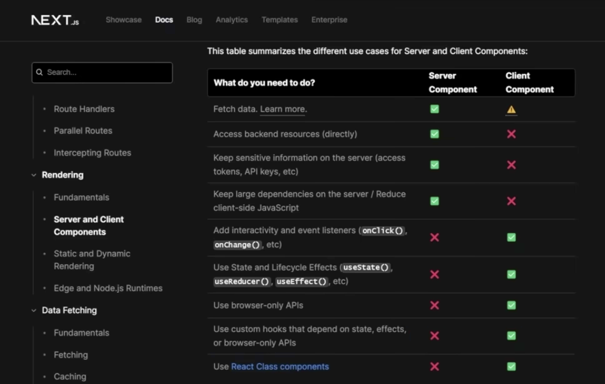

# React Vs Nextjs 

## Rendering 
- react render on client side (on browser or client side)
- when a user request a web page, the server send an html and js code that is rendered on browser or client side
-  while for next the render is choose
-  when a user request a page, the server side render request and teh code and retuurn the fully rendered page for imediate display
  

## Routing
next js use file-based routing system

# code splitting
lazy loading code splitting 

nextgs is not an entirely new technology
it is still fundamentally built on top
of react its purpose is to simplify
certain tasks allowing developers to
concentrate on the core react code 

nexgs
manages a variety of features such as
routing code splitting search engine
optimization and rendering automatically
# 
server side rendering improve seo andnextgs leverages server-side rendering
to enhance the initial page loading
speed resulting in improved SEO and user
experience

State Management in react is primarily
handled on the client side

# when to use server vs client side components

# 
error js must be a client component

# fetch data 

## ssr
with
SSR each request to the server triggers
a new rendering cycle and data fetch
ensuring that the content is always up
to date

page is rendered on each call to server

## static side generation
data fetched and cached for data that is not changed frequently 
nextgs uses static site generation it
will automatically fetch this data right
here but it will also cache it this
method is ideal for Content that doesn't
change frequently such as blog posts

## incrementalal static generation 
with incremental static generation you
can specify certain data to be
statically fetched at build time while
defining a revalidation time interval
this means that the data will be cached
but after a specific time frame it's
then going to refresh it and you're
always going to have new data making
this The Best of Both Worlds 

understand more about seo 